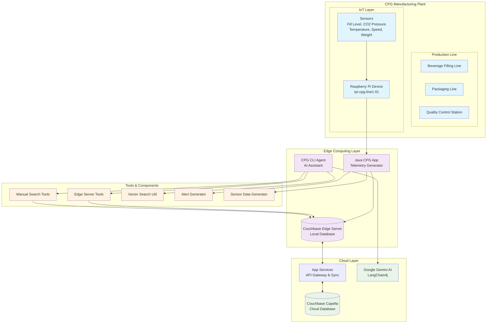
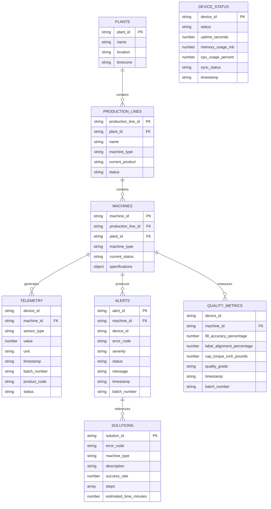

# CPG Manufacturing AI Assistant

A comprehensive AI-powered system for Consumer Packaged Goods (CPG) manufacturing operations, featuring real-time telemetry generation, intelligent troubleshooting, and edge computing capabilities.

## 🏗️ System Architecture



## 📊 Data Collections & Relationships



## 🛠️ Components Overview

### Core Applications

| Component | Purpose | Technology | Port/Location |
|-----------|---------|------------|---------------|
| **Couchbase Edge Server** | Local data storage & sync | Couchbase | :59840 |
| **Java CPG App** | IoT telemetry generation | Java 17, CBLite | Container |
| **CPG CLI Agent** | AI-powered troubleshooting | Java, LangChain4j | Local |
| **Python Setup Tools** | Data initialization | Python 3.8+ | Scripts |
| **Couchbase Capella** | Cloud database & analytics | Couchbase Cloud | Cloud |
| **App Services** | API gateway & sync gateway | Couchbase Cloud | :4984 |

### AI Tools & Utilities

| Tool | Description | Used By |
|------|-------------|---------|
| **EdgeServerTools** | Real-time operational data access | CLI Agent |
| **ManualSearchTools** | Documentation & solution search | CLI Agent |
| **VectorSearchUtil** | Semantic search capabilities | Manual Search |
| **AlertGenerator** | Production alert simulation | IoT Generator |
| **SensorDataGenerator** | Sensor reading simulation | IoT Generator |

### Data Collections

| Collection | Data Type | Retention | Index Fields |
|------------|-----------|-----------|--------------|
| `manufacturing.telemetry` | Sensor readings | 30 days | machine_id, sensor_type, timestamp |
| `manufacturing.alerts` | Production alerts | 90 days | severity, status, error_code |
| `manufacturing.quality_metrics` | Quality measurements | 365 days | machine_id, quality_grade |
| `manufacturing.device_status` | Device health | 7 days | device_id, status |
| `manufacturing.solutions` | Troubleshooting guides | Permanent | error_code, machine_type |
| `manufacturing.machines` | Machine definitions | Permanent | machine_id, production_line_id |
| `manufacturing.production_lines` | Line configurations | Permanent | production_line_id, plant_id |
| `manufacturing.plants` | Plant information | Permanent | plant_id |

## 🚀 Quick Start

### Prerequisites

- **Docker & Docker Compose** (20.10+)
- **Java 17+** (for local development)
- **Python 3.8+** (for setup scripts)
- **Google Gemini API Key** (for AI features)
- **Couchbase Capella Account** (for cloud sync)

### 1. Cloud Setup (Optional but Recommended)

#### Setup Couchbase Capella

1. **Create Capella Cluster:**

   ```bash
   # Visit https://cloud.couchbase.com/
   # Sign up/in and create a new cluster
   # Choose "Developer Pro" or higher for App Services
   ```

2. **Create Database and Collections:**

   ```bash
   # In Capella Console:
   # 1. Create bucket: "cpg_manufacturing"
   # 2. Create scope: "manufacturing"
   # 3. Enable App Services for the bucket
   ```

3. **Configure App Services:**

   ```bash
   # In App Services section:
   # 1. Create App Service endpoint
   # 2. Configure sync function for collections
   # 3. Set up user authentication
   # 4. Note down the App Services URL
   ```

4. **Update Configuration:**

   ```bash
   # Edit edge-server-config.json with your Capella details:
   # - Replace "your-cluster.apps.cloud.couchbase.com" with actual URL
   # - Update username/password in replication config
   # - Configure channels and collection sync
   ```

### 2. Environment Setup

```bash
# Clone the repository
git clone <repository-url>
cd cursor

# Set up environment variables
export GOOGLE_GEMINI_API_KEY="your-api-key-here"
export APP_SERVICES_CLUSTER="your-cluster.apps.cloud.couchbase.com"
export APP_SERVICES_API_KEY="your-api-key"

# Make scripts executable
chmod +x run-edge-server.sh run-java-app.sh setup.sh
```

### 3. Start Edge Server

```bash
# Start Couchbase Edge Server
./run-edge-server.sh --build

# Verify Edge Server is running
curl http://localhost:59840/
```

### 4. Initialize Data

```bash
# Install Python dependencies
pip install -r setup/requirements.txt

# Run system setup (creates collections, indexes, sample data)
cd setup
python setup_system.py
```

### 5. Start IoT Data Generation

```bash
# Start telemetry data generation
./run-java-app.sh

# Or run locally with Maven
./run-java-app.sh --local
```

### 6. Use CLI Agent

```bash
# Interactive mode
java -cp target/classes:$(mvn dependency:build-classpath -q -Dmdep.outputFile=/dev/stdout) \
     com.couchbase.example.cli_agent.CPGCLIAgent

# Single command mode
java -cp target/classes:$(mvn dependency:build-classpath -q -Dmdep.outputFile=/dev/stdout) \
     com.couchbase.example.cli_agent.CPGCLIAgent "Get recent telemetry for MACHINE_001"
```

## 📋 Usage Examples

### CLI Agent Commands

**Operational Data Queries:**

```bash
# Get machine telemetry
"Get recent telemetry for MACHINE_001"

# Check production alerts
"Show active alerts for beverage filling line"

# Device status check
"Check device status for rpi-cpg-line1-01"

# Quality metrics
"Get quality metrics for MACHINE_001"
```

**Documentation Search:**

```bash
# Search procedures
"Search manuals for CO2 pressure calibration"

# Find solutions
"Find solutions for fill level problems"

# Troubleshooting guides
"Get troubleshooting procedures for beverage_filling_line"
```

**Combined Analysis:**

```bash
# Comprehensive troubleshooting
"Analyze FILL_001 error on MACHINE_001"

# Process optimization
"Help with CO2 pressure issues on beverage line"
```

### REST API Endpoints

**Edge Server APIs:**

```bash
# Database info
GET http://localhost:59840/cpg_manufacturing

# Query telemetry
POST http://localhost:59840/cpg_manufacturing/_query
{
  "query": "SELECT * FROM manufacturing.telemetry WHERE machine_id = 'MACHINE_001' ORDER BY timestamp DESC LIMIT 10"
}

# Get active alerts
POST http://localhost:59840/cpg_manufacturing/_query
{
  "query": "SELECT * FROM manufacturing.alerts WHERE status = 'active' ORDER BY severity DESC"
}
```

## 🔧 Configuration

### Edge Server Configuration

Key configuration files:

- `edge-server-config.json` - Edge server settings
- `docker-compose.yml` - Container orchestration
- `setup/config.py` - Python setup configuration

### Cloud Configuration (Capella & App Services)

#### Couchbase Capella Setup

1. **Create Capella Cluster:**

   ```bash
   # Visit https://cloud.couchbase.com/
   # Create a new cluster with CPG Manufacturing bucket
   ```

2. **Configure App Services:**
   - Database Name: `cpg_manufacturing`
   - Sync Gateway Port: `:4984`
   - Admin Interface: `:4985`

3. **Replication Configuration in `edge-server-config.json`:**

   ```json
   "replications": [
     {
       "source": "wss://your-cluster.apps.cloud.couchbase.com:4984/cpg_manufacturing",
       "target": "cpg_manufacturing",
       "continuous": true,
       "collections": {
         "manufacturing.plants": { "channels": ["CPG_PLANT_001"] },
         "manufacturing.production_lines": { "channels": ["CPG_PLANT_001"] },
         "manufacturing.machines": { "channels": ["CPG_PLANT_001"] },
         "manufacturing.solutions": { "channels": ["solutions"] }
       },
       "auth": {
         "user": "admin",
         "password": "Password@12345"
       }
     }
   ]
   ```

#### Data Flow Architecture

- **Edge → Cloud:** Telemetry, alerts, device status, quality metrics
- **Cloud → Edge:** Plants, production lines, machines, solutions
- **Bidirectional Sync:** Real-time synchronization with conflict resolution

### Environment Variables

| Variable | Description | Default |
|----------|-------------|---------|
| `GOOGLE_GEMINI_API_KEY` | AI service API key | Required |
| `EDGE_SERVER_HOST` | Edge server hostname | `couchbase-edge-server` |
| `EDGE_SERVER_PORT` | Edge server port | `59840` |
| `APP_SERVICES_CLUSTER` | Capella App Services endpoint | `your-cluster.apps.cloud.couchbase.com` |
| `APP_SERVICES_API_KEY` | App Services API key | Required for cloud sync |
| `DEVICE_ID` | IoT device identifier | `rpi-cpg-line1-01` |
| `MACHINE_ID` | Machine identifier | `MACHINE_001` |
| `PRODUCTION_LINE` | Production line name | `BEVERAGE_LINE_A` |

### Machine Types & Products

**Supported Machine Types:**

- `beverage_filling_line` - Carbonated beverage filling
- `packaging_line` - Product packaging and labeling
- `quality_control_station` - Quality inspection

**Product Codes:**

- `CB_COLA_355` - Cola 355ml
- `CB_LEMON_500` - Lemon soda 500ml
- `CB_ORANGE_355` - Orange soda 355ml

## 📊 Monitoring & Observability

### Health Checks

```bash
# Edge Server health
curl http://localhost:59840/

# Container status
docker compose ps

# Logs
docker compose logs -f couchbase-edge-server
docker compose logs -f java-cpg-app
```

### Data Verification

```bash
# Check document counts
curl http://localhost:59840/cpg_manufacturing/manufacturing.telemetry/_count

# View recent telemetry
curl http://localhost:59840/cpg_manufacturing/manufacturing.telemetry/_all_docs?limit=5&descending=true
```

### Cloud Monitoring

#### Capella Dashboard

1. **Access Capella Console:**

   ```bash
   # Visit https://cloud.couchbase.com/
   # Navigate to your cluster dashboard
   ```

2. **Monitor Data Sync:**
   - Check bucket document counts
   - Monitor App Services sync status
   - View replication activity logs

#### App Services Monitoring

```bash
# App Services Admin Interface
curl https://your-cluster.apps.cloud.couchbase.com:4985/

# Check sync gateway status
curl https://your-cluster.apps.cloud.couchbase.com:4985/_db/cpg_manufacturing

# Monitor replication activity
curl https://your-cluster.apps.cloud.couchbase.com:4985/_db/cpg_manufacturing/_active_tasks
```

#### Replication Health

```bash
# Check Edge Server replication status
curl http://localhost:59840/cpg_manufacturing/_replications

# View sync metrics
docker compose logs java-cpg-app | grep -i "sync\|replication"
```

## 🗂️ Project Structure

```text
cursor/
├── src/main/java/com/couchbase/example/
│   ├── cli_agent/          # AI-powered CLI agent
│   │   ├── CPGCLIAgent.java
│   │   ├── EdgeServerTools.java
│   │   └── ManualSearchTools.java
│   └── iot_device/         # IoT telemetry generation
│       ├── CPGIoTTelemetryGenerator.java
│       ├── AlertGenerator.java
│       └── SensorDataGenerator.java
├── setup/                  # Python setup scripts
│   ├── setup_system.py
│   ├── document_processor.py
│   ├── sample_data_generator.py
│   └── couchbase_client.py
├── data/                   # Local data storage
│   ├── edge-server/        # Edge server data
│   └── cblite/            # CBLite databases
├── config/                 # Configuration files
├── edge-server-config.json # Edge server configuration
├── docker-compose.yml      # Container orchestration
├── run-edge-server.sh      # Edge server startup
├── run-java-app.sh         # Java app startup
└── setup.sh               # Complete setup script
```

## 🚨 Troubleshooting

### Common Issues

**Edge Server Won't Start:**

```bash
# Check port availability
lsof -i :59840

# View logs
docker compose logs couchbase-edge-server

# Restart with clean data
./run-edge-server.sh --clean
```

**Java App Compilation Errors:**

```bash
# Clean rebuild
mvn clean compile

# Check Java version
java -version

# Verify dependencies
mvn dependency:tree
```

**Replication Issues:**

```bash
# Check Edge Server connectivity
curl http://localhost:59840/cpg_manufacturing

# View replication status
docker compose logs java-cpg-app | grep -i replication
```

**Cloud Sync Issues:**

```bash
# Test Capella connectivity
curl -I https://your-cluster.apps.cloud.couchbase.com:4984/

# Check App Services authentication
curl -u admin:password https://your-cluster.apps.cloud.couchbase.com:4984/cpg_manufacturing

# Verify replication configuration
cat edge-server-config.json | jq '.replications'

# Check sync gateway logs in Capella Console
# Navigate to App Services → Logs in Capella dashboard
```

**Authentication Errors:**

```bash
# Update credentials in edge-server-config.json
# Check Capella user permissions
# Verify App Services database access
# Test with curl:
curl -u username:password https://your-cluster.apps.cloud.couchbase.com:4984/cpg_manufacturing
```

### Performance Tuning

**Memory Settings:**

```bash
# Increase Java heap size
export JAVA_OPTS="-Xmx1g -Xms512m"

# Edge Server memory limit
# Edit docker-compose.yml: GOMEMLIMIT=1GiB
```

**Data Retention:**

```bash
# Adjust retention in IoTDeviceConfig.java
TELEMETRY_EXPIRATION_DAYS = 30
ALERT_EXPIRATION_DAYS = 90
```

## 🤝 Contributing

1. **Development Setup:**

   ```bash
   git clone <repository-url>
   ./setup.sh
   ```

2. **Code Style:**
   - Java: Follow Oracle Java conventions
   - Python: PEP 8 compliance
   - Documentation: Update README for new features

3. **Testing:**

   ```bash
   mvn test
   python -m pytest setup/tests/
   ```

## 📝 License

This project is licensed under the MIT License - see the [LICENSE](LICENSE) file for details.

## 🔗 References

- [Couchbase Edge Server Documentation](https://docs.couchbase.com/edge-server/current/)
- [Couchbase Capella Documentation](https://docs.couchbase.com/cloud/current/)
- [App Services Documentation](https://docs.couchbase.com/couchbase-lite/current/android/replication.html)
- [Couchbase Mobile Sync](https://docs.couchbase.com/sync-gateway/current/)
- [LangChain4j Documentation](https://docs.langchain4j.dev/)
- [Google Gemini AI API](https://ai.google.dev/docs)
- [CPG Manufacturing Standards](https://www.couchbase.com/solutions/manufacturing/)
- [Couchbase Cloud Console](https://cloud.couchbase.com/)
